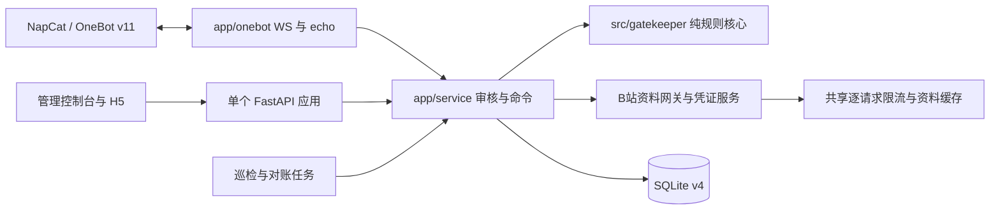

# V3 独立运行架构

默认入口是 `python -m app.main`，由单个 FastAPI/ASGI 生命周期管理 OneBot WebSocket、审核服务、管理接口、可选 H5 和后台任务。默认应用不初始化、也不导入 NoneBot。

## 代码职责

| 路径 | 职责 |
| --- | --- |
| `app/main.py`、`app/runtime.py` | 统一 ASGI、连接注册、启动、后台任务和关闭 |
| `app/onebot/` | 正向连接/重连、反向 WS、Action echo、事件队列 |
| `app/service.py`、`app/commands.py` | 事件编排、权限、模拟、清晰反馈与通知 |
| `src/gatekeeper/` | 数据模型、解析、T/F/I、AST、管道和纯格式化 |
| `app/config.py`、`app/legacy_config.py` | SQL 配置版本与首次旧来源编译 |
| `app/database/` | v4 迁移、业务事务、runtime_state、受限查询 |
| `app/gatekeeper/` | 局部 pending 预约、精确请求对账 |
| `app/bilibili/` | UID/搜索、WBI、逐请求限流、缓存、凭证 |
| `app/ownership.py`、`app/patrol.py` | 可选所有权证明、入群后复查与退群策略 |
| `app/web/` | 管理 API/UI 与所有权 H5 |
| `app/nonebot_adapter.py` | 显式可选 NoneBot 事件/动作桥，使用同一新服务 |
| `src/plugins/` | 归档旧实现和回归材料，不能处理 v4 数据 |

WS 接收循环与事件处理分开，审核等待动作回包时接收循环仍能处理 echo。明确 retcode 失败与超时/断线分别建模，未知不能自动当失败重试。

## 一致性与进程边界

SQLite WAL 存放配置历史、审计、归属、退群和扩展状态。配置保存使用 SQL 写事务与版本 CAS；公开快照隐藏秘密。业务审批先落盘意图，再执行外部动作，最终只确认一次。同步 SQLite 工作通过异步存储边界执行。

受支持部署为一个应用进程、一个 Uvicorn worker。不要用 `--workers 2` 或同时运行旧、新 Bot。SQL CAS 可以阻止配置丢失更新，不能把多个接收相同 OneBot 事件的进程变成受支持的集群。

默认启动显式禁用 Uvicorn 的代理头预处理，由应用根据实际回环对端和 SQL 信任设置处理。自行用 Uvicorn 工厂启动时，也要传 `--no-proxy-headers`，不能先改写客户端与 HTTPS 状态再绕过应用校验。

## 请求控制

默认 B站请求速率为每秒 2 次，可用基础设施 `BILI_REQUESTS_PER_SECOND` 调整。平滑门控作用于每个 HTTP 请求，独立于审核工作流并发上限（默认 4）与总超时（60 秒）。资料缓存默认 60 秒、最多 1024 项；包含账号凭证和策略作用域，不缓存最终审批结果。

限流不能保证避免风控。真实接口受 Cookie、账号状态、隐私、接口变更和请求积压影响；队列中等待也可能触发工作流总超时，结果应保持 I。

## 与旧架构的区别

[ADR 0001](adr/0001-sqlite-record-storage.md) 和 [ADR 0002](adr/0002-framework-independent-core.md) 记录此前阶段。V3 的当前决策见 [ADR 0003](adr/0003-standalone-runtime-sql-config.md)。旧插件安装、独立 `ThreadingHTTPServer`、持续合并四源业务配置和 pending 全局暂停的说明已被替代。

保留旧源码不等于允许旧插件读取 v4 数据库。旧 schema3 程序会拒绝新库，回退必须按[部署文档](deploy-systemd.md)核对数据兼容性。
